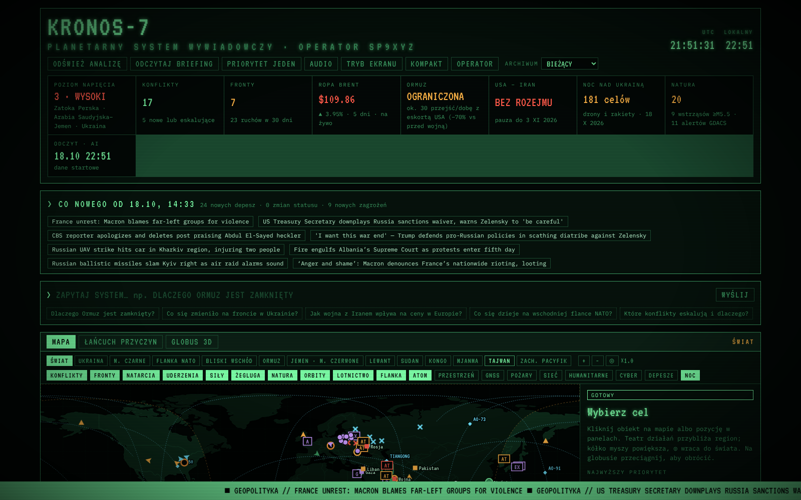
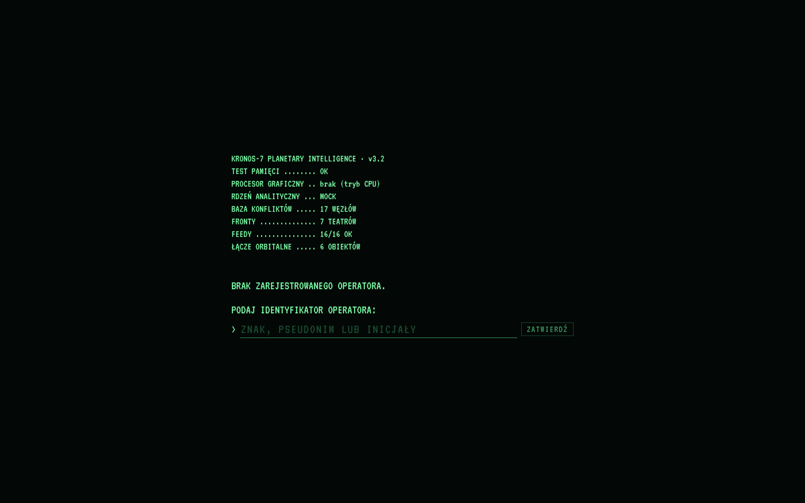

# KRONOS-7 · planetarny system wywiadowczy

Lokalny terminal w stylu komputerów pokładowych z filmów science fiction. Pokazuje **co, gdzie i dlaczego** dzieje się na świecie. Dane online pobiera sam, a analizę robi model AI działający na Twoim komputerze (Ollama lub LM Studio), bez chmury i bez kluczy API.

> **English:** the whole interface and the AI output can be switched to English in the OPERATOR window (or on the first-run screen). KRONOS-7 is a local, retro sci-fi styled world-intelligence dashboard. It pulls news and open data feeds (shipping, outages, disasters, markets, satellites…), and a local LLM (auto-selected for your GPU via Ollama) clusters, rates and explains events in Polish. Run `start.bat` on Windows or `./start.sh` on Linux/macOS, then open http://127.0.0.1:7707. On first launch you set your operator callsign.



## Nowe w v3.9

- **Satelity:** kliknięcie satelity pokazuje kartę: rodzaj i misję, właściciela i operatora, datę i miejsce startu, orbitę (apogeum, perygeum, okres, nachylenie), opis z Wikipedii, częstotliwości nadajników z bazy SatNOGS oraz przycisk **WYJAŚNIJ (AI)**. Na mapie widać ślad podsatelitarny (−15…+90 min) i zasięg widoczności.
- **Przeloty nad QTH** (panel pod SITREP): AOS/LOS, maksymalna elewacja, azymuty, przesunięcie Dopplera dla częstotliwości, oznaczenie przelotów widocznych gołym okiem i alarm przed przelotem. Lokalizację (lokator Maidenhead albo współrzędne) wpisujesz w oknie OPERATOR; domyślnie IO91. Obliczenia idą w osobnym wątku przeglądarki.
- **Lotnictwo:** wykrywanie samolotów krążących po orbicie (rozpoznanie, tankowanie, patrol) – przerywany okrąg na mapie i lista „Krążące teraz” w panelu NIEBO. **ODTWÓRZ** (przy mapie) cofa mapę do 48 h wstecz: samoloty co minutę, okręty, tankowce i statki z sankcjami co 10 minut. NOTAM-ów nie ma, bo wszystkie sensowne źródła wymagają płatnych kluczy.
- **Morze:** statki z listy sankcji OFAC (dopasowanie po IMO), „ciemne” statki (przestały nadawać AIS w obserwowanych rejonach), możliwe przeładunki STS (dwa tankowce burta w burtę), statki stojące nad kablami podmorskimi; warstwa **KABLE** (submarinecablemap.com). Wyróżnienia na mapie i listy w panelu STATKI; w FILTRACH opcja „tylko podejrzane”.
- **Historia i raport:** baza `data/history.db` (SQLite) – wskaźniki co godzinę (rok), zdarzenia (90 dni), pozycje (48 h). Panel **HISTORIA** z wykresami (24 h, 7 dni, 30 dni, rok) i przycisk **RAPORT DZIENNY** – strona do wydruku lub zapisu jako PDF.
- **Powiadomienia na telefon** przez Telegram (bot) lub Discord (webhook): wzrost napięcia, briefing, krążące samoloty, kody alarmowe, sankcje, STS, kable, „ciemne” statki, przeloty satelitów. Rodzaje wybierasz w oknie OPERATOR, przycisk **WYŚLIJ TEST** sprawdza połączenie. Limit: 1 wiadomość na 5 s i 40 na godzinę.
- **Licznik do następnej analizy AI** w nagłówku – widać, kiedy karta graficzna będzie zajęta.
- **AUTO-ZOOM** – przełącznik przy mapie; wyłączony nie przybliża mapy po kliknięciu obiektu.
- **XENEON EDGE (2560×720):** w oknie EKRAN tryb panoramiczny (mapa, szczegóły i status w jednym rzędzie) albo osobne okno 2560×720 do przeciągnięcia na ten ekran.
- **Telefon i tablet:** w oknie OPERATOR możesz udostępnić terminal w sieci domowej (z PIN-em, po ponownym uruchomieniu). Na telefonie „Dodaj do ekranu głównego” tworzy ikonę jak aplikacja. Ustawienia da się zmieniać tylko na komputerze.
- **Polecenia głosowe** (przycisk GŁOS albo Alt+V), np. „sitrep Bałtyk”, „pokaż Ormuz”, „odśwież”, „briefing”, „odtwórz”, „na żywo”, „warstwa kable”, „pełny ekran”; wszystko inne trafia jako pytanie do AI. W Chrome i Edge rozpoznawanie mowy przetwarzają serwery Google/Microsoft.
- Wydajność: mapa rysowana na płótnie, obliczenia orbit i przelotów w osobnym wątku, zapis historii w tle.

## GeoConfirmed z oryginałami, naprawiony łańcuch przyczyn (v3.22.2)
- **Karta punktu GeoConfirmed**: opis, sprzęt, jednostki, rodzaj materiału, miejscowość oraz linki do oryginału (Telegram, X) i geolokalizacji – z ukrytego API szczegółów GeoConfirmed.
- **POSTY I ZDJĘCIA przy punkcie GeoConfirmed**: na górze oryginalny post z Telegrama (zdjęcia/film) i treść posta z X (oficjalny oEmbed, bez klucza), niżej relacje z Telegrama, Bluesky itd. z tego miejsca i 2 dni od daty. Nazwy miejscowości po ukraińsku, rosyjsku i angielsku KRONOS bierze z OpenStreetMap (Nominatim, raz na miejsce).
- **PODSUMUJ (AI)** dostaje opis GeoConfirmed i ocenia, które relacje dotyczą tego samego zdarzenia.
- **v3.22.3 – OpenSky:** odrzucone client_id/secret nie blokują już śladu lotu (działa wtedy bez konta), a test źródła pokazuje czytelny komunikat, co zrobić.
- **Łańcuch przyczyn**: przy podkładach kafelkowych (CIEMNA SZCZEGÓŁOWA, SATELITA, OSM) mapa zasłaniała graf – naprawione.

## Test połączenia źródeł (v3.22)
- **ŹRÓDŁA I INTEGRACJE**: na górze okna pasek z podsumowaniem („STAN: 16 OK · 2 z błędem · 15 wyłączonych”) i przyciskiem **TESTUJ WSZYSTKO** – KRONOS od razu łączy się ze wszystkimi źródłami naraz (do ok. minuty). Na liście STAN ŹRÓDEŁ każde źródło ma własny przycisk **TEST**.
- Wynik przy źródle: OK z liczbą danych, BŁĄD z opisem (odmowa dostępu, za dużo zapytań, brak połączenia…) albo „wyłączone”; do tego godzina testu, czas odpowiedzi i uwaga.
- Testowane są: AI lokalne i w chmurze, samoloty, statki (Digitraffic, aisstream.io), wszystkie źródła wywiadowcze, Telegram (kanały i konto), wyszukiwarki, Copernicus, OpenSky, Stadia, bot Telegram i Discord (bez wysyłania wiadomości), poczta, odbiorniki SDR, Home Assistant.
- **v3.22.1 – filtr śmieci w wyszukiwaniu Telegrama:** wyniki z konta Telegram (cały Telegram) nie omijają już filtra. Odrzucane są kanały „towarzyskie”, kasyna, narkotyki i inny spam doklejający nazwy miast i hashtagi. Zostają tylko wpisy o ataku lub wybuchu, a z całego Telegrama dodatkowo tylko te z nazwą miejsca. Prywatne rozmowy nigdy nie trafiają do zestawień, a zdjęcia spamu nie są pobierane.
- **Na bieżąco:** KRONOS sam testuje wszystko co godzinę w tle (bez AI w chmurze, bo test zużywa zapytanie z limitu). Wynik w panelu STATUS SYSTEMU, wiersz ŹRÓDŁA – kliknięcie otwiera szczegóły.

## Więcej źródeł: Izrael, mapy ISW, GeoConfirmed, WarSpotting, Copernicus (v3.21)
Bez klucza (działa od razu):
- **Alarmy w Izraelu (Tzeva Adom / Pikud HaOref)** – warstwa ALARMY IL, sekcja w panelu alarmów, powiadomienia, zestawienie postów i zdjęć dla miejsca alarmu, wejście do zdarzeń złożonych.
- **Mapy ISW / CTP** – warstwa ISW: ocenione postępy Rosji, infiltracje, zdobycze z 24 h, terytorium deklarowane przez Rosję, kontrofensywy UA.
- **GeoConfirmed** – warstwa GEOCONFIRMED: zgeolokalizowane nagrania i zdjęcia (Ukraina, Izrael, Sudan, Syria, Mjanma – lista w ŹRÓDŁA I INTEGRACJE).
- **WarSpotting** – panel STRATY SPRZĘTU: potwierdzone zdjęciami straty sprzętu RU/UA z ostatnich dni; trafiają też do analizy AI.
- **EMSC** – trzęsienia ziemi M3.5+ z 48 h (warstwa EMSC, sekcja w panelu alarmów, wejście do zdarzeń złożonych – pomaga odróżnić wybuch od wstrząsu).
- **Oryx** (RSS) i 57 nowych kanałów RSS, 5 kanałów gubernatorów obwodów przygranicznych Rosji w katalogu Telegrama.
- **Bluesky** i **GDELT** – dodatkowe wyszukiwarki w zestawieniach POSTY I ZDJĘCIA.
- **OpenSky** – przycisk ŚLAD LOTU w karcie samolotu (bez konta z limitem).

Z darmowym kluczem (ŹRÓDŁA I INTEGRACJE – przy każdym polu jest instrukcja):
- **Copernicus Data Space** – przyciski SENTINEL-2 / RADAR S-1 / SWIR w podglądzie satelitarnym (zdjęcia 10 m z ostatnich dni; radar widzi przez chmury).
- **Cloudflare Radar** – wyłączenia i anomalie internetu na świecie (sekcja w panelu alarmów, wejście do zdarzeń złożonych i analizy).
- **Reddit**, **YouTube**, **VK** – dodatkowe wyszukiwarki w zestawieniach (Reddit działa też bez klucza, ale często blokuje).

Pominięte: EURDEP (europejska sieć pomiaru promieniowania) nie udostępnia publicznego API z danymi – zostaje Safecast.

## Posty, zdjęcia i nagrania przy zdarzeniach + konto Telegram (v3.20)

- **Zdjęcia i nagrania z Telegrama:** KRONOS zapisuje miniatury zdjęć i filmów z postów śledzonych kanałów w `data/media`, więc nie znikają, gdy kanał usunie post. Filmy pobierają się przy pierwszym odtworzeniu, do 60 MB. Pamięć trzyma pliki 10 dni, łącznie najwyżej 1,5 GB.
- **Zestawienie przy każdym zdarzeniu:** w kartach alarmu UA, zdarzenia złożonego, incydentu morskiego i posta OSINT jest sekcja **POSTY I ZDJĘCIA**:
  - KRONOS szuka nazw miejsc we wszystkich pisowniach i odmianach (ukraińskiej, rosyjskiej, angielskiej i polskiej, np. Харків/Харкові/Харьков/Kharkiv/Charków) oraz postów, które AI umieściło w pobliżu, w oknie czasu wokół zdarzenia;
  - wyniki to galeria zdjęć i nagrań oraz lista postów z oceną wiarygodności i linkiem do oryginału;
  - **PODSUMUJ (AI)** pisze zestawienie: co potwierdza kilka źródeł, a co twierdzi tylko jedna strona;
  - póki karta jest otwarta, zestawienie odświeża się co 2 minuty.
- **Podgląd:** pełny ekran, strzałki ←/→, filmy odtwarzane w KRONOS-ie. Przyciski **Sprawdź, czy już krążyło** (Google Lens, Yandex) służą do wyłapania starych albo cudzych nagrań. Zdjęcia są domyślnie rozmyte, bo bywają drastyczne; przycisk BEZ ROZMYCIA to wyłącza.
- **Konto Telegram** (ŹRÓDŁA I INTEGRACJE → TELEGRAM – KONTO):
  - logowanie: api_id i api_hash z my.telegram.org, numer telefonu, kod z Telegrama i hasło dwuetapowe;
  - zestawienia przeszukują wtedy także wszystkie Twoje kanały i grupy (`messages.searchGlobal`) oraz publiczne posty z całego Telegrama: po hashtagach bez limitu, pełnotekstowo w darmowej dziennej puli (`channels.searchPosts`, KRONOS nigdy nie płaci gwiazdkami);
  - konto działa tylko w trybie odczytu;
  - sesja jest w pliku `data/tg_account.session`, WYLOGUJ ją usuwa;
  - biblioteka Telethon instaluje się przyciskiem w tym samym oknie.

## Hugging Face bez błędów (v3.19)

W oknie **MODELE…**:
- **Wyszukiwarka Hugging Face:** pokazuje tylko modele w formacie GGUF, bo tylko takie Ollama potrafi pobrać. Kliknięcie **WARIANTY** wyświetla pliki (kwantyzacje) z rozmiarem i oceną dopasowania do sprzętu. Zalecany wariant ma ★ (zwykle Q4_K_M). Warianty podzielone na kilka plików są pomijane, bo Ollama ich nie pobierze.
- **Wklejanie nazwy albo linku:** można wkleić link do strony modelu albo pliku na huggingface.co, link z ollama.com albo polecenie `ollama run …`. KRONOS sam zamienia to na poprawną nazwę.
- **Sprawdzanie przed pobraniem** z czytelnym komunikatem zamiast „400”:
  - repozytorium bez GGUF (z podpowiedzią, żeby szukać wersji GGUF),
  - nieistniejący wariant (z listą dostępnych),
  - repozytorium nieistniejące albo prywatne,
  - model z ograniczonym dostępem.
- **Modele z ograniczonym dostępem** (Llama, Gemma itp.): Hugging Face nie przyjmuje przy pobieraniu nazwy użytkownika i hasła, a Ollama loguje się własnym kluczem. Okno pokazuje ten klucz z przyciskiem KOPIUJ i instrukcję: zaakceptuj licencję na stronie modelu, dodaj klucz w Settings → SSH and GPG Keys, pobierz ponownie. Token HF (rodzaj „Read”) jest opcjonalny i służy tylko do przeglądania prywatnych repozytoriów.
- **Modele oznaczone jako za duże** da się pobrać mimo to, po podwójnym kliknięciu.

## Wybór i pobieranie modeli lokalnych (v3.18)

OPERATOR → przycisk **MODELE…** przy polu „Model AI”:
- **Zainstalowane:** każdy model ma ocenę, jak zmieści się na Twoim sprzęcie. Przycisk **UŻYJ** ustawia go jako aktywny (albo wybierasz AUTOMATYCZNIE), **✕** usuwa go z dysku po potwierdzeniu.
- **Polecane dla Twojego sprzętu:** 13 sprawdzonych modeli (Qwen3 1.7b–32b, Gemma 3, Llama 3.1, Phi-4, DeepSeek-R1, Mistral Small 3.2, gpt-oss) z opisem i oceną dopasowania:
  - zielony: w całości na karcie, szybko;
  - bursztynowy: MoE, częściowo w RAM, ale nadal szybko (np. qwen3:30b, gpt-oss:20b);
  - szary: część w RAM albo procesor, wolno;
  - czerwony: za duży.
  W nagłówku okna KRONOS podpowiada najszybszy dobry model i ten o najlepszej jakości.
- **Inny model:** wpisujesz dowolną nazwę z ollama.com/library (albo `hf.co/…` z Hugging Face) i klikasz **POBIERZ**. Widać postęp, a po pobraniu model może od razu zostać aktywnym.
- Długość kontekstu dobiera się do wybranego modelu.
- Pobieranie i usuwanie działa z Ollamą. W LM Studio modele pobiera się w jego własnym oknie, a tu tylko się je wybiera.

## AI w chmurze, zdarzenia złożone, graf powiązań, promieniowanie, ACLED (v3.17)

**AI w chmurze** (OPERATOR → AI W CHMURZE…)
- Dostawcy: Google Gemini, GitHub Models, Groq, OpenRouter, OpenAI, Anthropic Claude albo dowolny serwer zgodny z OpenAI. Wybierasz dostawcę, wklejasz klucz, pobierasz listę modeli i klikasz TEST.
- Osobno decydujesz, co idzie do chmury:
  - główna analiza i briefing (domyślnie tak),
  - pytania, SITREP i archiwum (domyślnie tak),
  - AI w tle: Telegram, alerty morskie i korelacje (domyślnie nie, bo zjada darmowe limity).
- Jeśli chmura nie odpowiada, KRONOS sam przechodzi na lokalny model i robi przerwę: 10 minut przy przekroczonym limicie (429), godzinę przy odrzuconym kluczu, 3 minuty przy braku sieci.
- Okno pokazuje dzisiejszą liczbę zapytań, tokenów, błędów i przejść na lokalny model.
- Do chmury idą tylko publiczne depesze, posty i dane z mapy.

**Zdarzenia złożone, bez dublowania alarmów** (warstwa KORELACJE i panel ZDARZENIA ZŁOŻONE)
- KRONOS zbiera sygnały ze wszystkich warstw: samoloty (krążenie, kody alarmowe), statki („ciemne”, STS, kable, sankcje), alarmy UA, incydenty morskie, Telegram OSINT, NOTAM-y, zakłócenia GPS, pożary z satelity, trzęsienia ziemi, promieniowanie i ACLED.
- Sygnały z tego samego rejonu i czasu łączy w jedno zdarzenie. Potrzebne są co najmniej dwie różne warstwy i jedna z nich musi być „ostra”, więc stałe tło (np. zakłócanie GPS nad Kaliningradem razem z NOTAM-em) samo zdarzenia nie tworzy.
- AI ocenia każde nowe lub zmienione zdarzenie:
  - czy sygnały są naprawdę powiązane, czy to przypadek,
  - czy to rutyna,
  - co się prawdopodobnie dzieje,
  - wagę w skali 1–5,
  - czy to to samo co już znane zdarzenie (wtedy je scala).
- **Jedno powiadomienie na zdarzenie** (przy wadze od 3 w górę, ponownie tylko gdy waga wzrośnie). Pojedyncze alarmy z rejonu zgłoszonego zdarzenia są wyciszane, a ten sam alarm o tym samym statku czy samolocie idzie najwyżej raz na 6 godzin. Kodów alarmowych samolotów (7500/7600/7700) nic nie wycisza.
- Zdarzenia złożone trafiają też do głównej analizy i briefingu.

**Graf powiązań statku** (w karcie statku, sekcja POWIĄZANIA)
- Pokazuje statek, właściciela, zarządcę handlowego i zarządcę bezpieczeństwa (ISM), ubezpieczyciela P&I, spółki-matki, banderę i dawne bandery, listy sankcyjne oraz inne statki tych samych firm („flota”). Biała obwódka oznacza statek, który jest teraz na mapie; kliknięcie go otwiera.
- Do tego dawne nazwy, typ, rok budowy, nośność, status (sankcje, flota cieni, zatrzymania w portach) i opis z bazy wywiadu Ukrainy.
- Dane: OpenSanctions (lista morska) i baza „War & Sanctions” wywiadu Ukrainy (GUR). Pobierane raz w tygodniu, około 40 MB, na dysku zajmują około 1 MB. Licencja CC BY-NC 4.0, czyli tylko do użytku niekomercyjnego.
- **Więcej sankcji na mapie:** oprócz OFAC statki są teraz sprawdzane na listach UE, Wielkiej Brytanii, Szwajcarii, Kanady, ONZ i Ukrainy. Dopasowanie idzie po IMO, a gdy statek go nie nadaje, po MMSI.

**Promieniowanie** (warstwa PROMIENIOWANIE)
- Sieć Safecast na żywo, bez klucza: około 150 aktywnych stacji, w tym kilkadziesiąt w Ukrainie.
- Każda stacja ma własne tło liczone z kilku dni. Alarm włącza się, gdy odczyt wyraźnie je przekracza (ponad 2,5 raza i ponad 0,3 µSv/h), a nie tylko gdy jest „wysoki”. Powiadomienie najwyżej raz na 12 godzin na stację.

**ACLED** (warstwa ACLED, klucz w ŹRÓDŁA I INTEGRACJE)
- Bitwy, ostrzały, naloty i przemoc wobec cywilów z dokładnym miejscem, stronami i liczbą ofiar, z ostatnich 14 dni (do zmiany).
- Logowanie e-mailem i hasłem konta myACLED. **Uwaga:** konta „Open” z prywatnym adresem e-mail mogą nie mieć dostępu do API. Wtedy stan źródła pokaże to wprost.

## Statki tylko dla widoku (v3.16)

- Serwer wysyła do przeglądarki tylko statki z widocznego obszaru mapy, z zapasem na przesuwanie. Gdy przesuniesz mapę dalej, sam dociąga nowy obszar. Przykład: widok Ormuzu to kilkaset statków i kilka kilobajtów, a nie ~45 tys. statków i ok. 1 MB co odświeżenie.
- Przy oddaleniu (widok szerszy niż ok. 45°) zwykłe statki łączą się w **kratki z liczbą**. Kolor kratki to przeważająca kategoria spośród włączonych w FILTRACH. Kliknięcie kratki przybliża mapę.
- Okręty, straż, SAR i statki z listy obserwacji (sankcje, „ciemne”, nad kablami) zawsze są pokazywane osobno.
- Grupowanie można wyłączyć w FILTRACH. Liczby w FILTRACH i nagłówku panelu STATKI dotyczą wszystkich statków na serwerze.

## Płynniej i chłodniej, więcej źródeł (v3.15)

**Mapy lokalnie**
- Kafelki podkładów (CIEMNA SZCZEGÓŁOWA, CIEMNA SZARA, SATELITA, OSM NOCNA) idą przez serwer KRONOS i zostają na dysku w `data/tiles`. Każdy kafelek pobiera się z internetu tylko raz, potem ładuje się z dysku od razu, także bez internetu.
- Przycisk **⬇** przy wyborze podkładu otwiera okno **MAPY OFFLINE**:
  - pobieranie całego świata (np. do poziomu 6, ok. 120 MB) albo widocznego obszaru (np. do poziomu 10–12),
  - postęp pobierania i rozmiar pamięci,
  - czyszczenie.
- Pobieranie idzie w tle, ok. 8 kafelków na sekundę. OpenStreetMap nie pozwala na pobieranie hurtowe, więc dla OSM zapamiętywane są tylko obejrzane miejsca.
- Przyciemnienie satelity i odwrócenie kolorów OSM liczone są raz na kafelek, w osobnym wątku przeglądarki. Przesuwanie i zoom nie blokują już strony.
- Klucz Stadia Maps (jeśli go masz) jest teraz używany przez serwer, więc mapa szczegółowa działa też na telefonie w sieci domowej.

**Mniej pracy dla karty graficznej**
- Mapa rysowana jest najwyżej 30 razy na sekundę i tylko wtedy, gdy coś się zmieniło.
- **Tryb oszczędny** (OPERATOR albo klawisz **E**, także `/api/cmd?do=eco&arg=toggle`, np. z akcji „Otwórz stronę” na Stream Decku):
  - bez poświaty, linii skanowania, winiety i pulsujących znaczników,
  - do 10 klatek na sekundę,
  - samoloty odświeżane co 2 s.
- **Okno w tle:** gdy okno KRONOS nie jest aktywne (np. grasz na drugim monitorze), animacje stoją, a mapa rysuje się najwyżej 2 razy na sekundę. Można to wyłączyć w OPERATOR.
- **AI w tle tylko z analizą** (domyślnie): streszczenia postów z Telegrama i alertów morskich liczą się na początku głównej analizy, a nie co 10 minut. Do tego czasu nowe posty widać w oryginale. Dawne zachowanie: OPERATOR → „NA BIEŻĄCO”.
- **Zwalnianie modelu po analizie** (opcja w OPERATOR): Ollama usuwa model z pamięci karty od razu po analizie, a nie po 5 minutach.

**Więcej źródeł**
- **Telegram OSINT:** katalog 98 sprawdzonych, aktywnych kanałów w grupach. Zaznaczasz je w oknie ŹRÓDŁA I INTEGRACJE, domyślnie włączonych jest 27. Można dopisać własne.
  - Ukraina: Siły Powietrzne, Sztab, HUR, SBU, DeepState, administracje obwodów, media.
  - Rosja: MO, MSZ, TASS, Rybar, Dwa Majora i inni milblogerzy; ASTRA, Meduza i inne media niezależne.
  - Białoruś: NEXTA, Zierkało.
  - Izrael, Iran i świat arabski: IDF, Abu Ali Express, PressTV, IRNA, Al Mayadeen.
  - OSINT: Liveuamap, AMK Mapping, TankerTrackers, Rerum Novarum, Clash Report.
  - Cyber.
- Każdy kanał ma opisany rodzaj (oficjalne, media, milbloger, propaganda), a AI bierze go pod uwagę przy ocenie wiarygodności. Reklamy i bardzo krótkie wpisy są odrzucane, zanim trafią do AI. Najpierw przetwarzane są źródła oficjalne i OSINT.
- **RSS:** 57 nowych sprawdzonych źródeł, razem 79.
  - Analizy wojskowe: ISW, The War Zone, Defense One, Naval News, The Aviationist, Long War Journal, War on the Rocks, Bellingcat, OSW, Defence24.
  - Komunikaty rządowe: MON Wielkiej Brytanii, Pentagon, Departament Stanu.
  - Rosja i Ukraina: Kyiv Post, Ukrainska Pravda EN, Meduza, Moscow Times, Nowaja Gazieta Europe.
  - Bliski Wschód: Times of Israel, Al-Monitor, Iran International, Middle East Eye, The National, Asharq Al-Awsat.
  - Azja: The Diplomat, SCMP, Taipei Times, Japan Times, NHK, Yonhap, NK News, Dawn, The Hindu.
  - Afryka: Africanews, AllAfrica.
  - Ameryka Łacińska: InSight Crime, MercoPress.
  - Polska: TVN24, RMF24.
  - Żegluga: Maritime Executive, Splash247, Hellenic Shipping News.
  - Cyber: Krebs, The Hacker News, SecurityWeek, Dark Reading.
- Z jednego źródła brane jest najwyżej 25 najnowszych wiadomości, żeby duże serwisy nie zagłuszały reszty. Więcej źródeł to więcej potwierdzeń tego samego zdarzenia, a od tego zależy ocena wiarygodności.

## Wywiad+, odbiorniki, mapa szczegółowa (v3.14)

Ustawienia: **OPERATOR → ŹRÓDŁA I INTEGRACJE…** (tam też stan każdego źródła).

**Dane wywiadowcze**
- **Alarmy przeciwlotnicze w Ukrainie** na żywo (warstwa ALARMY UA): bez klucza, a z darmowym tokenem alerts.in.ua także rodzaj zagrożenia i części obwodów. Powiadomienia dla wybranych obwodów.
- **DeepStateMap** (warstwa DEEPSTATE): obszary okupowane, wyzwolone i sporne oraz kierunki natarć – prawdziwa linia frontu, aktualizowana kilka razy dziennie.
- **NOTAM-y** (FAA NOTAM API, darmowy klucz): zamknięte przestrzenie, strzelania, starty rakiet, drony i zakłócenia GNSS w rejonach informacji lotniczej (FIR) obserwowanych regionów.
- **„Ciemne” statki z radaru SAR** (Global Fishing Watch, darmowy klucz): wykrycia statków bez AIS w obserwowanych akwenach.
- **Kanały OSINT na Telegramie** (bez logowania): lokalne AI wybiera posty o konkretnych zdarzeniach, tłumaczy je, streszcza, ocenia wiarygodność w skali Admiralicji i łączy powtórzenia między kanałami. Najważniejsze trafiają do briefingu.
- **Zdjęcia satelitarne NASA** w kartach konfliktów, incydentów, alarmów i postów: kolor, pożary albo światła nocne (przerwy w dostawach prądu).

**Twoje odbiorniki (SDR)**
- **ADS-B** z readsb / dump1090 / tar1090 (adres aircraft.json) – warstwa MOJE ADS-B, wojskowe i alarmowe wyróżnione, zasięg anteny.
- **AIS** – zdania NMEA po UDP z AIS-catcher, rtl_ais itp.; statki trafiają do warstwy STATKI.
- **APRS-IS** – stacje wokół QTH (tylko odbiór).

**Więcej statków:** pamięć pozycji wydłużona do 24 h; publiczny strumień AIS Norwegii (Kystverket, bez klucza); własne strumienie NMEA po TCP; AISHub (wymiana danych dla właścicieli odbiorników). W panelu STATKI widać, ile statków jest na mapie, ile w pamięci i ile ukrywają filtry.

**Mapa szczegółowa:** lista przy mapie – WEKTOR (dotychczasowa), CIEMNA SZCZEGÓŁOWA (Stadia Maps), CIEMNA SZARA (Esri), SATELITA (Esri, przyciemniona) i OSM NOCNA. Podkłady kafelkowe używają rzutu Merkatora jak mapy internetowe i pozwalają przybliżać do poziomu ulic.

**Wygoda**
- **Wyszukiwarka** przy mapie (klawisz /): MMSI, nazwa, IMO, znak wywoławczy statku; adres ICAO, znak, rejestracja i typ samolotu; znaki APRS.
- **Pytania o przeszłość** – przycisk ARCHIWUM albo pytanie typu „co działo się w Ormuzie w zeszłym tygodniu?”: AI odpowiada z archiwum odczytów, bazy zdarzeń i incydentów.
- **Widżet** dla ekranów dodatkowych: `http://127.0.0.1:7707/widget` (dla angielskiego `?lang=en`) – poziom napięcia, odliczanie analizy, liczniki, przelot satelity, ostatni kontakt. Można go wczytać w widżecie przeglądarki iCUE na XENEON EDGE, na tablecie albo drugim monitorze.
- **Home Assistant** – webhook dostaje zdarzenia (z polami kind, text, level) i PRIORYTET JEDEN. Przykład automatyzacji: wyzwalacz Webhook `kronos7`, warunek `{{ trigger.json.kind == 'priority' }}`, akcja: czerwone światło.
- **Poczta** – alerty UKMTO, MDAT-GoG, IFC-IOR (i inne) zamówione e-mailem trafiają do panelu BEZPIECZEŃSTWO MORSKIE: wpisz skrzynkę IMAP (najlepiej osobną, z hasłem aplikacji). KRONOS tylko czyta.

## Bezpieczeństwo morskie (v3.12)

Panel **BEZPIECZEŃSTWO MORSKIE** i warstwa mapy **INCYDENTY MORSKIE**: piractwo, ataki, porwania, abordaże oraz ostrzeżenia nawigacyjne (miny, zakłócenia GNSS, strzelania i starty rakiet, zamknięte akweny). Źródła, wszystkie oficjalne i bez kluczy, sprawdzane co 30 minut:

| Źródło | Co daje | Zasięg |
|---|---|---|
| NGA MSI (USA) | ostrzeżenia NAVAREA, HYDROLANT, HYDROPAC z pozycją i obszarem | cały świat |
| UKHO (Wielka Brytania) | ostrzeżenia radiowe NAVAREA I i przybrzeżne UK | północno-wschodni Atlantyk, UK |
| IMB Piracy Reporting Centre (ICC) | incydenty piractwa i rabunku z pozycją | cały świat |
| ReCAAP ISC | incydenty z pozycją, statkiem i opisem | Azja |
| EUNAVFOR ATALANTA | komunikaty operacji UE | Somalia, Zatoka Adeńska |
| MARAD MSCI (USA) | ostrzeżenia i porady dla żeglugi | strefy ryzyka |

- **Bez powtórzeń:** ten sam incydent zgłoszony przez kilka źródeł (np. IMB i ReCAAP) jest pokazywany raz, z listą wszystkich zgłoszeń. Łączenie robi program (ten sam statek, numer ostrzeżenia, miejsce i czas), a w wątpliwych przypadkach decyduje lokalne AI. Powiadomienia też idą tylko raz.
- **Analiza AI:** każde zgłoszenie z ostatnich 30 dni lokalne AI czyta tylko raz: pisze krótki tytuł i streszczenie, ustala rodzaj i wagę (1–5). Robi to porcjami i nie wtedy, gdy trwa główna analiza. Incydenty z ostatniego tygodnia trafiają do briefingu i oceny poziomu napięcia.
- Karta incydentu: streszczenie, oryginalne zgłoszenia z linkami, statek, pozycja; dla świeżych zdarzeń przycisk odtworzenia ruchu statków i samolotów z tej chwili. Ostrzeżenia pokazują swój obszar na mapie.
- Powiadomienia Telegram/Discord (rodzaj „Incydent bezpieczeństwa morskiego”), licznik w HISTORII i na Stream Decku (wtyczka 1.1).
- Na razie bez UKMTO (do zrobienia osobno). MDAT-GoG (Zatoka Gwinejska), IFC-IOR (Ocean Indyjski) i EUNAVFOR ASPIDES nie mają danych do automatycznego pobierania albo nie dało się ich sprawdzić. MARAD bywa blokowany przez zaporę serwera – wtedy w panelu widać „✕” przy tym źródle.

## Dźwięki i głos lektora (v3.11)

**OPERATOR → DŹWIĘKI I GŁOS LEKTORA…**

- **Głosy Microsoftu (v3.13):** Marek i Zofia po polsku, Ryan, Thomas, Sonia i Libby po angielsku – te same neuronowe głosy co „Czytaj na głos” w Edge, ale odtwarzane przez serwer KRONOS-a, więc działają w Chrome, Brave i na telefonie. Kliknij **ZAINSTALUJ** (biblioteka edge-tts, ok. 5 MB). Wymagają internetu, tekst trafia do serwerów Microsoftu; to nieoficjalny dostęp, więc jeśli Microsoft go zablokuje, KRONOS przełączy się na Pipera albo głos przeglądarki.
- **Głos lektora** (briefing, SITREP): zamiast słabego głosu przeglądarki KRONOS może czytać lokalnym neuronowym syntezatorem **Piper** – działa offline na procesorze, nie zajmuje karty graficznej i ma dobre polskie głosy (Darkman, Gosia, MC Speech) oraz brytyjskie (Alan, Northern English, Cori, Alba). Kliknij **POBIERZ** przy głosie: program (ok. 25 MB) i głos (ok. 60 MB) ściągną się same do `data/tts`. Do tego tempo czytania i efekt „komputera pokładowego” (pasmo radiowe i metaliczny pogłos). Bez Pipera można wybrać dowolny głos przeglądarki – w Edge najlepiej brzmią głosy „Online (Natural)”.
- **Własne dźwięki:** każde zdarzenie – start, koniec analizy, wzrost napięcia, syrena PRIORYTET JEDEN, nowy kontakt, alarm squawk/AIS-SART, sankcje/STS/kable, przelot satelity, przyciski, dalekopis, praca rdzenia AI, szum tła – może grać Twój plik (MP3, WAV, OGG, M4A, FLAC, do 15 MB), wbudowany syntezator albo nic. Każdy ma osobną głośność i przycisk odsłuchu. Pliki wgrywasz przeciągając je do okna albo wrzucasz do `data/sounds`.

## Stream Deck (v3.10)

Wtyczka w `streamdeck/dist/com.vipersq.kronos7.streamDeckPlugin` – kliknij plik dwa razy, a aplikacja Stream Deck sama ją zainstaluje (wymaga Stream Deck 6.4 lub nowszego). Akcje pojawią się w kategorii **KRONOS-7**. Przyciski działają, gdy KRONOS jest uruchomiony, a polecenia mapy i głosu – gdy terminal jest otwarty w przeglądarce (może być w tle albo na innym monitorze).

| Akcja | Co pokazuje | Naciśnięcie |
|---|---|---|
| Poziom napięcia | 1–5 z kolorem, przy 5 miga | otwiera terminal |
| Analiza AI | odliczanie do analizy; w trakcie postęp % (GPU zajęte) | uruchamia analizę |
| Teatr działań | nazwa regionu, podświetlony gdy aktywny | przybliża mapę |
| Warstwa mapy | WŁ./WYŁ. | przełącza warstwę |
| Licznik kontaktów | samoloty, rozpoznanie, tankowce, bombowce, krążące, statki, okręty, sankcje, „ciemne”, STS, kable; miga przy nowym kontakcie | pokazuje ostatni kontakt na mapie |
| Przelot satelity | odliczanie do najbliższego przelotu nad QTH, AOS/LOS, elewacja | pokazuje satelitę |
| Polecenie | briefing, SITREP (z regionem), pytanie do AI, stop, odśwież, PRIORYTET JEDEN, globus, AUTO-ZOOM, odtwarzanie, zoom, widok, kontakt, audio, głos, raport, terminal | wykonuje polecenie |
| Pokrętło (Stream Deck +) | zoom mapy, odtwarzanie 48 h albo wybór teatru – na ekranie dotykowym | obrót / naciśnięcie / dotyk |

Ustawienia przycisku (region, warstwa, licznik, polecenie, tryb pokrętła, adres serwera) są w panelu pod przyciskiem w aplikacji Stream Deck; tam też jest **SPRAWDŹ POŁĄCZENIE**. Żółty trójkąt na przycisku oznacza, że terminal nie jest otwarty albo serwer nie działa.

Polecenia można też wysyłać z innych programów: `http://127.0.0.1:7707/api/cmd?do=theater&arg=hz` (do: theater, layer, zoom, replay, briefing, sitrep, ask, stop, globe, autozoom, alert, audio, view, event, sat, voice, refresh). Stan dla przycisków: `/api/deck`.

Budowanie wtyczki ze źródeł: `cd streamdeck && npm install && npm run pack`.

## Instrukcja obsługi (PDF)

**[docs/KRONOS-7-Instrukcja.pdf](docs/KRONOS-7-Instrukcja.pdf)** – instalacja, wszystkie ustawienia i skąd wziąć każdy klucz API, krok po kroku. Źródło: `docs/manual/instrukcja.html`, składanie: `node docs/manual/build_pdf.mjs`.

## Szybki start

```
git clone https://github.com/vipersq/Kronos-7.git
cd Kronos-7
start.bat            (Windows)
./start.sh           (Linux / macOS, wymaga python3 i ollama)
```

Albo pobierz ZIP (zielony przycisk **Code → Download ZIP**), rozpakuj i uruchom `start.bat`.

## Operator

Przy pierwszym uruchomieniu terminal pyta o **identyfikator operatora**: znak wywoławczy, pseudonim albo inicjały (1–20 znaków).



Później zmienisz go przyciskiem **OPERATOR** w nagłówku. Tam ustawisz też:

- jak system ma się do Ciebie zwracać (np. imię, używane w powitaniu i briefingu);
- do 3 godzin automatycznej analizy (domyślnie 05:50 i 17:50);
- model AI: automatyczny dobór albo jeden z zainstalowanych;
- czy pobierać zalecany model automatycznie.

Ustawienia trafiają do `data/settings.json`. Ten plik nie jest w repozytorium, więc `git pull` ich nie nadpisze. Ustawienia z tego pliku mają pierwszeństwo przed `config.json`.

## Instalacja (Windows)

Uruchom **`start.bat`**. Skrypt sam:

1. sprawdzi Pythona, a jeśli go nie ma, zapyta o zgodę i zainstaluje Pythona 3.12 (przez winget);
2. doinstaluje dodatki pycountry i h3;
3. sprawdzi Ollamę (silnik lokalnego AI), a jeśli jej nie ma, zapyta o zgodę i ją zainstaluje: przez winget albo instalatorem z ollama.com;
4. uruchomi serwer i otworzy terminal pod adresem http://127.0.0.1:7707;
5. pobierze model AI dobrany do karty graficznej (na RTX 5080: qwen3:14b, ok. 9 GB, jednorazowo), a potem od razu zrobi pierwszą analizę. Postęp widać na pasku pod nagłówkiem.

Jeśli odmówisz instalacji Ollamy, terminal działa bez analizy AI, a pytanie nie wraca. Aby przywrócić pytanie, usuń plik `data\.no_ollama`. Automatyczne pobieranie modelu wyłączysz w `config.json` (`"auto_pull": false`).

Potem system odświeża się sam o 5:50 i 17:50, a analizę można też uruchomić przyciskiem **ODŚWIEŻ ANALIZĘ**.

## Dobór modelu do sprzętu

Przy starcie program sprawdza kartę graficzną (VRAM przez `nvidia-smi`, a dla AMD i Intela przez rejestr Windows) oraz pamięć RAM. Na tej podstawie wybiera model:

| VRAM            | Model        | Rozmiar |
|-----------------|--------------|---------|
| 24 GB i więcej  | qwen3:32b    | 20 GB   |
| 14–23 GB        | qwen3:14b    | 9,3 GB  |
| 8–13 GB         | qwen3:8b     | 5,2 GB  |
| 5–7 GB          | qwen3:4b     | 2,6 GB  |
| bez GPU         | według RAM: 8b / 4b / 1.7b na procesorze |

Na RTX 5080 (16 GB) wybór padnie na **qwen3:14b**. Jeśli masz już zainstalowany inny model, który mieści się w pamięci, program użyje go od razu, a w panelu zaproponuje pobranie zalecanego. Zamiast Ollamy możesz używać LM Studio (serwer na porcie 1234), które jest wykrywane automatycznie.

Ustawienia są w `config.json`:
- `"model": "auto"` możesz zamienić na konkretną nazwę, np. `"gemma3:12b"`.
- `model_catalog` to tabela powyżej. Gdy pojawią się nowsze modele, wystarczy dopisać je tutaj.
- `refresh_times` to godziny briefingów.
- `feeds` to źródła wiadomości z oceną wiarygodności.

## Na żywo: samoloty i statki

**Samoloty wojskowe** (warstwa LOTNICTWO, panel NIEBO) odświeżają się co 10 sekund z adsb.fi, a zapasowo z adsb.lol. Oba serwisy są darmowe i nie wymagają klucza. Między odczytami samolot płynie po mapie według kursu i prędkości. Za samolotem widać trasę z ostatnich 30 minut. Po kliknięciu pojawiają się:

- kraj (z adresu ICAO);
- model i operator;
- rok produkcji;
- wysokość, prędkość i kurs;
- wiek pozycji.

Rozpoznanie, tankowce i bombowce są wyróżnione kolorem. Gdy taki samolot wleci w obserwowany rejon (Morze Czarne, Bałtyk, Polska, Ormuz, Morze Czerwone, Tajwan i inne), pojawia się komunikat i sonarowy sygnał. Samoloty z wyłączonym transponderem nie są widoczne. Dotyczy to zwykle maszyn bojowych nad Ukrainą i Rosją.

**Statki** (warstwa STATKI, panel STATKI) pochodzą z dwóch źródeł:

- **Digitraffic** (Finlandia): bez klucza, ale obejmuje tylko północny Bałtyk.
- **aisstream.io**: cały świat (albo tylko obserwowane rejony, do wyboru w oknie OPERATOR). Potrzebny jest darmowy klucz. Zaloguj się na https://aisstream.io przez GitHub, wejdź w **API Keys**, utwórz klucz i wklej go w oknie **OPERATOR**.

Przy statku widać:

- banderę (z MMSI), z oznaczeniem bander wygody;
- typ, cel podróży, wymiary i zanurzenie;
- prędkość i status (np. na kotwicy);
- link do MarineTraffic.

Panel liczy tankowce w każdym rejonie, osobno te pod rosyjską banderą i pod banderami wygody. Okręty zwykle wyłączają AIS.

Statki są pamiętane przez 6 godzin od ostatniego sygnału. Program zapisuje je na dysk (`data/ships.json.gz`), więc po restarcie mapa nie jest pusta. Starsze niż godzina pozycje są wyblakłe.

Statki, samoloty i chmury satelitów są rysowane na jednej warstwie graficznej, więc mapa płynnie pokazuje nawet kilkadziesiąt tysięcy obiektów. Najechanie myszą pokazuje nazwę, a kliknięcie otwiera szczegóły. Przycisk **FILTRY** przy mapie wybiera:
- typy statków: wojskowe, straż, tankowce, towarowe, pasażerskie, rybackie, jachty i inne;
- rodzaje samolotów: rozpoznanie, tankowce, bombowce, transport, myśliwce;
- trasy i podpisy na mapie.

Serwer pobiera samoloty i Digitraffic tylko wtedy, gdy terminal jest otwarty w przeglądarce. Wyłączysz je w `config.json` (`live_air`, `live_sea`).

## Co jest online, a co robi AI

**Feedy automatyczne (16, bez AI):** IMF PortWatch (ruch statków przez wąskie gardła, AIS), IODA (odcięcia internetu), adsb.fi / adsb.lol (migawka samolotów wojskowych dla AI), GDACS (alerty katastrof z torami cyklonów), CISA KEV (aktywnie wykorzystywane luki), NASA FIRMS (ogniska pożarów w rejonach walk), Launch Library 2 (starty), NBP (kursy złotego), GPSJam (zakłócenia GPS), WHO (ogniska chorób), NOAA NHC (huragany), ostrzeżenia podróżne USA i UK, OFAC (sankcje USA), ReliefWeb, Polymarket (prognozy rynkowe) i CelesTrak (stacja Tiangong).

**Na żywo co 5 minut:** ropa Brent i WTI, gaz TTF i Henry Hub, złoto, pszenica, USD/PLN, EUR/USD, S&P 500, VIX, Bitcoin (Yahoo Finance, zapasowo Stooq).

**Wiadomości dla AI:** BBC, Al Jazeera, Guardian, DW, France 24, NPR, ONZ, Crisis Group, Kyiv Independent, Ukrinform, USNI News, Defense News, Breaking Defense, Notes from Poland, gCaptain, ReliefWeb, The Record, BleepingComputer, SpaceNews, Spaceflight Now, TechCrunch i The Verge. Do tego USGS (trzęsienia) i AMSAT (orbity).

**Programowo, bez AI:** łączenie wiadomości o tym samym zdarzeniu, liczenie niezależnych źródeł, ocena wiarygodności w skali Admiralicji (A–F dla źródła, 1–6 dla informacji), pozycje satelitów (SGP4), strefa nocy, zmiany od poprzedniego odczytu.

**Lokalne AI:**
- depesze po polsku z polem „dlaczego”;
- karty konfliktów z przyczynami, osią czasu i scenariuszami na 30 dni;
- **fronty** (opis sytuacji, nowe natarcia, zmiany kontroli miejscowości; samej linii frontu AI nie przesuwa);
- **noc nad Ukrainą** (drony, rakiety, zestrzelenia);
- **uderzenia dalekiego zasięgu**, **ruchy sił**, **wschodnia flanka NATO**;
- **przestrzeń powietrzna**, **obiekty jądrowe**, **sankcje**, **kryzysy humanitarne**, **gospodarka**;
- stan rozejmu USA–Iran, **żegluga** (z danymi PortWatch), kalendarz;
- łańcuch przyczyn, komentarz „dlaczego” do ruchów na rynkach, poziom napięcia, briefing głosowy, odpowiedzi na pytania i SITREP.

Każdy moduł dostaje bieżącą listę i świeże wiadomości, a zwraca tylko zmiany. Scalaniem i usuwaniem starych wpisów zajmuje się kod, nie model.

Dane startowe w repozytorium (`data/seed.json`) to odczyt z 18.10.2026, 14:33. Pierwsza analiza na Twoim komputerze zacznie od nich.

## Funkcje terminala

- Układ dopasowuje się do ekranu (od telefonu po 4K). Przycisk **EKRAN** pozwala ustawić:
  - szerokość: pełna, wyśrodkowana albo wąska;
  - wielkość tekstu i przycisków (60–170%);
  - wysokość mapy.

  **PEŁNY EKRAN** ukrywa pasek przeglądarki.
- **Język polski lub angielski:** wybierasz go w oknie **OPERATOR** albo na ekranie powitalnym.
  - Zmienia się cały interfejs, nazwy krajów, typy statków i samolotów oraz głos briefingu.
  - Po wybraniu angielskiego lokalne AI pisze po angielsku: briefing, SITREP, odpowiedzi, karty konfliktów. Dotyczy to następnych analiz; wcześniejsze odczyty zostają w języku, w którym powstały.
- **Odpinanie paneli:** przycisk ⧉ w nagłówku każdego panelu (mapa, depesze, rynki, niebo, statki, status itd.) otwiera go w osobnym oknie, które przeciągasz na inny monitor.
  - W Chrome i Edge, po zgodzie na „zarządzanie oknami”, okno otwiera się od razu na drugim ekranie, na całą jego powierzchnię.
  - Kliknięcie w depeszę albo pozycję w panelu przybliża mapę także w odpiętym oknie.
  - Przyciski **PRZYPNIJ** (w głównym oknie) albo **PRZYPNIJ Z POWROTEM** (w odpiętym) wracają panel na miejsce.
- **SATELITY**: wybór grup z katalogu CelesTrak (około 16 000 aktywnych). Grupy to m.in.:
  - wojskowe i rozpoznawcze (USA, Kosmos, Yaogan, SAR-Lupe i inne), obiekty niezidentyfikowane;
  - nawigacyjne (GPS, GLONASS, Galileo, BeiDou), meteorologiczne, obserwacji Ziemi;
  - Starlink, OneWeb, Kuiper, Qianfan.

  Grupy pojawiają się na mapie jako punkty, które można kliknąć. Wyszukiwarka pozwala przypiąć dowolnego satelitę: dostaje wtedy nazwę i trasę orbity. Katalog jest pobierany raz na 12 godzin.
- Mapa 2D z powiększaniem (kółko myszy, teatry działań: Ukraina, Morze Czarne, flanka NATO, Bliski Wschód, Ormuz, Jemen, Lewant, Sudan, Kongo, Mjanma, Tajwan, Zachodni Pacyfik) albo globus 3D. Przy zbliżeniu włącza się dokładniejsza linia brzegowa.
- 19 warstw: konflikty, fronty, natarcia, uderzenia, siły, żegluga, natura, orbity, lotnictwo, flanka, atom, przestrzeń, GNSS, pożary, sieć, humanitarne, cyber, depesze, noc.
- **Łańcuch przyczyn:** kliknij węzeł, a zobaczysz ścieżkę przyczyn i skutków.
- **Co nowego:** nowe depesze, zmiany statusu konfliktów i nowe zagrożenia od poprzedniego odczytu.
- **Trend napięcia** i **archiwum** wszystkich odczytów (rozwijana lista ARCHIWUM).
- **Dźwięk terminala** (przycisk AUDIO), w stylu komputerów pokładowych z kina SF lat 70.: przekaźniki przy rozruchu, dalekopis drukujący odpowiedzi, „bulgotanie” rdzenia podczas pracy AI, buczenie maszynowni, sonarowy sygnał kontaktu, syrena przy wzroście poziomu napięcia. Całość z pogłosem metalowego wnętrza. Wszystko generowane na żywo w przeglądarce, bez plików audio. Głośność i szum tła ustawisz w oknie OPERATOR.
- **Briefing głosowy:** potrzebny jest polski głos w Windows (Ustawienia → Czas i język → Mowa → dodaj głos „Polski”).
- **Tryb ekranu:** pełny ekran z pokazem slajdów co 20 sekund, np. na XENEON EDGE. Wyjście klawiszem Esc.
- Zapytania do systemu, SITREP dla regionu, filtr „tylko A–B / 1–3”, oznaczanie przeczytanych i obserwowanych.

## Pliki

- `data/seed.json` – dane startowe z repozytorium (odczyt z 18.10.2026), żeby terminal nie był pusty przed pierwszą analizą
- `data/state.json` – Twój bieżący odczyt (lokalny, poza gitem)
- `data/archive/` – kopie każdego odczytu, ostatnie 120 (lokalne)
- `data/settings.json` – ustawienia operatora (lokalne)
- `data/osint_tg.json`, `data/mail_seen.json` – posty OSINT i przetworzone e-maile (lokalne)
- `data/marsec.json` – incydenty i ostrzeżenia morskie z analizą AI (lokalne)
- `data/sounds/` – Twoje pliki dźwiękowe; `data/tts/` – program Piper i pobrane głosy
- `data/history.db` – historia: pozycje, wskaźniki i zdarzenia (lokalne)
- `data/satinfo/`, `data/tle/`, `data/cables.json`, `data/ofac_vessels.json` – pamięć podręczna danych (lokalne)

## Uwagi

- Wszystkie oceny (poziom napięcia, scenariusze, stan szlaków, łańcuch przyczyn) to hipotezy modelu AI, a nie oficjalne wskaźniki. Mniejsze modele częściej się mylą.
- Serwer nasłuchuje tylko na tym komputerze (127.0.0.1), chyba że włączysz dostęp z sieci lokalnej (wtedy wymaga PIN-u).
- Test bez AI: ustaw zmienną `KRONOS_MOCK=1`, a program użyje atrapy modelu.
- Biblioteki i mapy dołączone w `web/vendor/` mają własne licencje, opisane w [THIRD_PARTY.md](THIRD_PARTY.md).
- Treści z kanałów RSS i serwisów danych należą do ich wydawców. Program tylko je pobiera i streszcza na Twoim komputerze.
